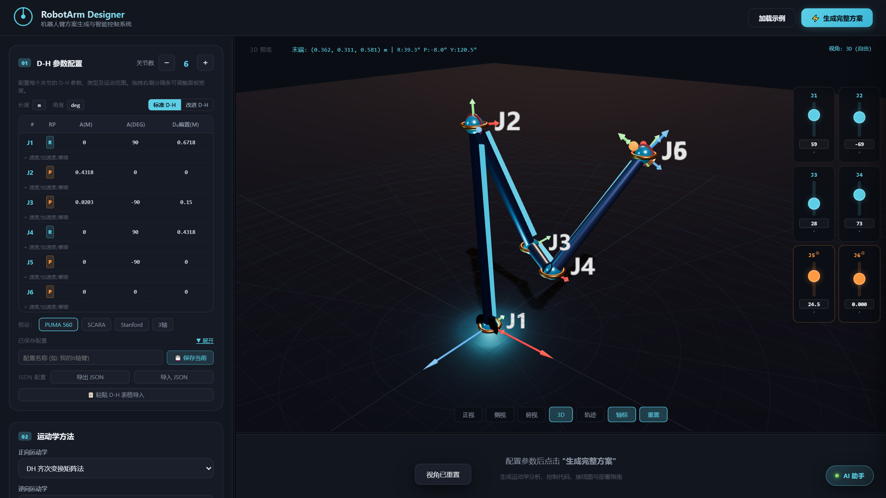
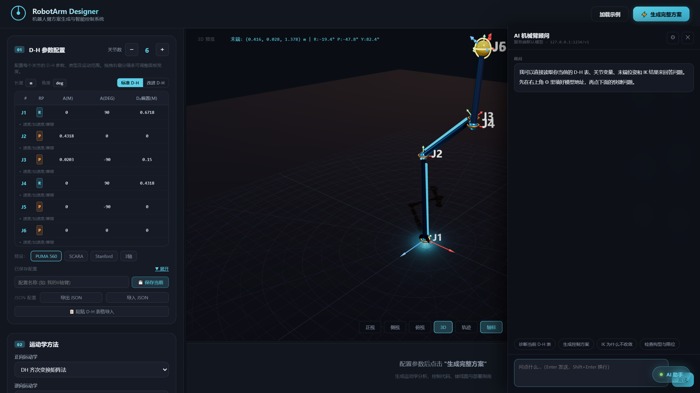
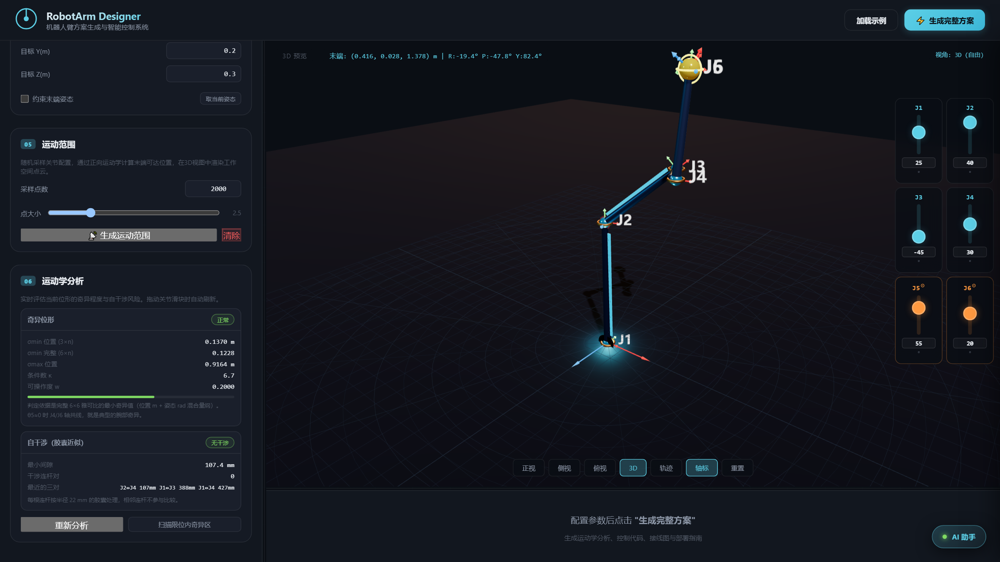

# RobotArm Designer

一个跑在浏览器里的**机械臂方案设计器**：填 D-H 参数表 → 实时看 3D 姿态 → 算正逆运动学 → 生成控制代码、接线图和部署指南。接一个大模型，它还能直接读你当前的参数表做诊断。

纯静态单页，零构建，不依赖后端。Three.js 已内置，断网可用。



## 功能

**建模与运动学**

- 1–12 自由度，支持旋转关节与移动关节混排
- **标准 D-H** 与**改进 D-H（Craig 前置约定）**两套约定，可一键互相换算（不会丢你手改的参数）
- 正向运动学两种实现：齐次变换矩阵法、POE 指数积法（螺旋轴 + se(3) 矩阵指数）
- 逆向运动学：阻尼最小二乘（DLS，带随机重启与两阶段阻尼）、CCD
- IK 支持**完整位姿约束**：位置 + 末端姿态（RPY 输入，或一键「取当前姿态」）
- 蒙特卡洛工作空间采样与点云渲染
- 内置预设：PUMA 560、SCARA、Stanford、3 轴示例

**工程分析**

- **奇异位形检测**：实时显示 σmin、σmax、条件数、可操作度；6 轴及以上用完整 6×n 雅可比判定（只看位置雅可比会漏掉腕部奇异）
- **限位内奇异区扫描**：随机采样 3000 个位形，统计接近奇异 / 已奇异的比例
- **自干涉检查**：连杆按胶囊体处理，两两计算最短距离（线段-线段），报出干涉对与间隙

**输出**

- 方案概览、运动学分析、控制代码（Arduino / STM32 / 树莓派）、接线图、部署指南，五个标签页
- 配置存 localStorage 多槽位，可导出 / 导入 JSON
- D-H 表格支持从论文或 Excel 直接粘贴（Tab / 逗号 / 空格分隔都认）

**AI 助手**

右侧抽屉，走 OpenAI 兼容的 `/chat/completions`，支持流式输出。每次提问会自动把当前约定、完整 D-H 表、关节变量、末端位姿、IK 结果、σmin、干涉信息压进 system prompt，不用复述参数。

支持 LM Studio、Ollama、DeepSeek、通义千问、OpenAI 和任意自定义端点。



## 快速开始

不能双击 `index.html` 用 `file://` 打开——ES module 和 importmap 会被 CORS 拦掉。起个静态服务即可：

```bash
python -m http.server 8000
# 或者
npx serve .
```

然后打开 <http://127.0.0.1:8000/>。

部署到 GitHub Pages / Vercel / Netlify 也行，是纯静态目录，不需要任何构建步骤。

## D-H 参数约定

两种约定常被混用，混错了模型就会「关节控制下一根连杆」。这里的定义：

| | 标准 D-H | 改进 D-H |
|---|---|---|
| 变换顺序 | `Rz(θ)·Tz(d)·Tx(a)·Rx(α)` | `Rx(α)·Tx(a)·Rz(θ)·Tz(d)` |
| 第 i 行参数 | `(aᵢ, αᵢ, dᵢ, θᵢ)` | `(aᵢ₋₁, αᵢ₋₁, dᵢ, θᵢ)` |
| 关节 i 绕 | `zᵢ₋₁` | `zᵢ` |
| 关节 i 位于 | `Oᵢ₋₁` | `Oᵢ` |

两者可以互相换算：改进 D-H 第 i 行的 `(a, α)` 等于标准表第 i−1 行的 `(a, α)`。切换约定时页面会做这个换算，而不是重置参数。

θ 偏置的语义是 `θ = θ₀ + q`：θ₀ 是固定的机械偏置（填在 `θ₀偏置` 列），q 是关节变量（拖滑块驱动）。这和 Corke 的 Robotics Toolbox 一致。表格里的「下限 / 上限」指的是 q 的范围，不含偏置。



## 接自己的模型

点右下角 AI 按钮 → ⚙ → 选 provider 或填 Base URL：

| Provider | Base URL | 说明 |
|---|---|---|
| LM Studio | `http://127.0.0.1:1234/v1` | 本地，需在 LM Studio 里开 server |
| Ollama | `http://127.0.0.1:11434/v1` | 本地，`ollama serve` |
| DeepSeek | `https://api.deepseek.com/v1` | 需要 API Key |
| 通义千问 | `https://dashscope.aliyuncs.com/compatible-mode/v1` | 需要 API Key |
| OpenAI | `https://api.openai.com/v1` | 需要 API Key |

点「拉取模型」可以列出端点上的可用模型。

**关于推理型模型**：Qwen3、gpt-oss 这类模型思考过程很长，`max_tokens` 给小了会把额度全花在思考上、正文为空。页面做了三层处理：系统提示词强制「3–6 条要点、300 字内」；本地 provider 自动附加 `reasoning_effort: "low"`；正文仍为空时自动用更严格的约束重试一次。⚙ 里也有「推理强度」下拉可以手动调。

**安全提醒**：API Key 存在浏览器的 localStorage 里，只在本机。不要在共用电脑上填生产环境的 Key。

## 项目结构

```
robot-arm-designer/
├── index.html              # 全部逻辑，单文件
├── vendor/
│   ├── three.module.min.js # Three.js r160（MIT）
│   └── addons/controls/OrbitControls.js
├── docs/
│   └── screenshots/
├── LICENSE
└── README.md
```

单文件是刻意的：拷走 `index.html` + `vendor/` 就能用，不需要 npm install，也不需要打包。

## 实现上几个容易踩的点

- **关节轴线取哪个 z**：标准 D-H 取变换**前**的 `z`（即 `zᵢ₋₁`），改进 D-H 取变换**后**的 `z`（即 `zᵢ`）。两者写反，模型看起来「关节装错了位置」，而且 IK 会彻底失效。
- **雅可比有限差分校验**：解析雅可比和 `(fk(q+ε) − fk(q−ε)) / 2ε` 对不上时，先查轴线，再查量纲。
- **位姿 IK 的量纲**：位置是米、姿态是弧度，直接混在一起求解会让姿态误差压过位置误差。这里用旋转矩阵的 log map 求姿态误差，再乘 0.25 做尺度平衡。
- **常数阻尼收不住**：DLS 前期需要大阻尼保证稳定，后期需要小阻尼才能把残差压到 1e-6 以下。改成随迭代衰减的两阶段阻尼，收敛率从 26/30 提到 30/30。
- **碰撞检测要跳过零长度连杆**：腕部 `a=0, d=0` 会让多个关节原点重合，不跳过的话全是误报。
- **零位天然奇异**：PUMA 在零位 θ₅=0，J4 与 J6 轴共线。这是构型属性不是参数错误，面板会单独标成「零位奇异」。

## 已知限制

- 不支持 `file://` 直接打开，必须起 HTTP 服务（ES module 的硬约束）。
- 手机端能用，但滑块区是贴底的横向滚动条，小屏上会压住 3D 视图底部一小块。
- 碰撞检测用的是胶囊体近似，不做凸包或网格级检测。
- 逆运动学是数值法，不保证全局收敛；目标超出关节限位时会明确报「未收敛」并给出残差。
- 生成的控制代码是模板化的参考实现，直接烧录前需要按实际舵机 / 驱动器改引脚和限位。

## 许可

MIT，见 [LICENSE](LICENSE)。Three.js 为 MIT，版权归 Three.js Authors。
